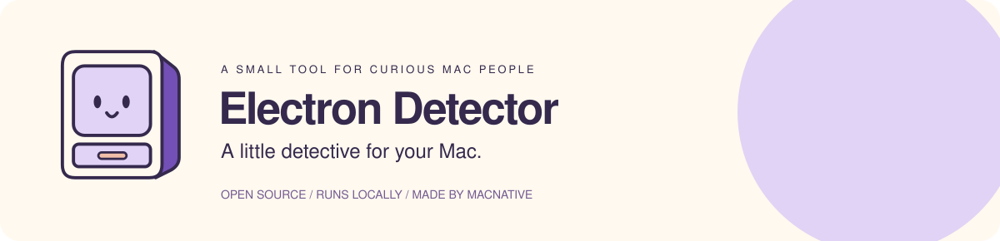
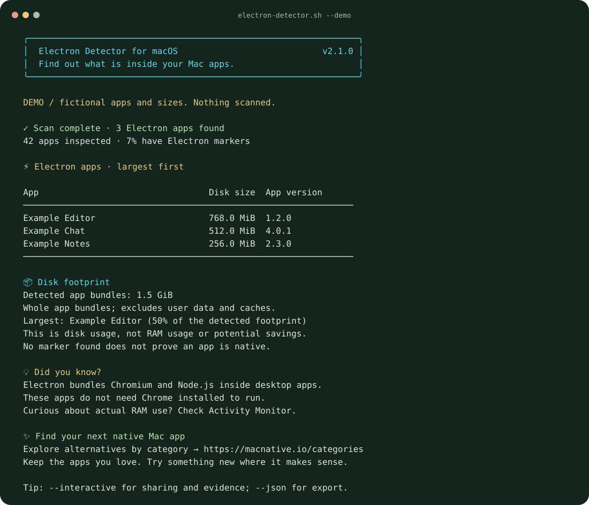

<p align="center">
  
</p>

Find Electron apps on your Mac in a colorful table, with sizes, versions, and a few useful facts.

**Free & open source. No Homebrew, account, or admin password.**

## Copy, paste, scan

Open **Terminal** (⌘ Space → Terminal) and paste this whole block:

```sh
curl -fL https://raw.githubusercontent.com/macnative/electron-detector/codex/friendly-app-census/electron-detector.sh -o electron-detector.sh &&
  bash electron-detector.sh --interactive
```

This downloads and runs the script. [Read the source first](electron-detector.sh) if you prefer. The command currently uses the **v2.1.0 preview branch**; `main` still has v1.

It scans `/Applications` and `~/Applications`, then lets you **copy a summary**, **inspect detection evidence**, or **browse native alternatives**. Scanning works offline and never changes your apps.

<p align="center">
  
</p>

*Fictional apps and sizes. Preview it yourself with `bash electron-detector.sh --demo`.*

## A few handy options

After the first download, run `bash electron-detector.sh` with any of these:

| Option | What you get |
| --- | --- |
| `--interactive` | Sharing, clipboard, evidence, and alternatives menu |
| `--share` | A summary without app names or paths |
| `--json` | A structured report for your own tools |
| `--path '/your/folder'` | Scan a different app folder |
| `--quiet` | Results without the banner, facts, or promotion |
| `--demo` | Try the UI without scanning |

Run `bash electron-detector.sh --help` for all options.

## What the results mean

The script looks for Electron's framework or executable inside each app. Renamed internals can be missed; **no match doesn't prove an app is native**.

Sizes are **whole app bundles on disk**, excluding user data and caches—not RAM use or estimated savings. Nothing is uploaded or posted. Full reports include app names; `--share` leaves them out.

## Find something more Mac-like

Made by **[MacNative](https://macnative.io)**. Curious about a different app? [Browse native alternatives by category →](https://macnative.io/categories)

Keep the apps you love. Try something new where it makes sense.

---

[How detection works & JSON reference](docs/reference.md) · [Contributing](CONTRIBUTING.md) · [Report a bug](https://github.com/macnative/electron-detector/issues) · [MIT license](LICENSE)
